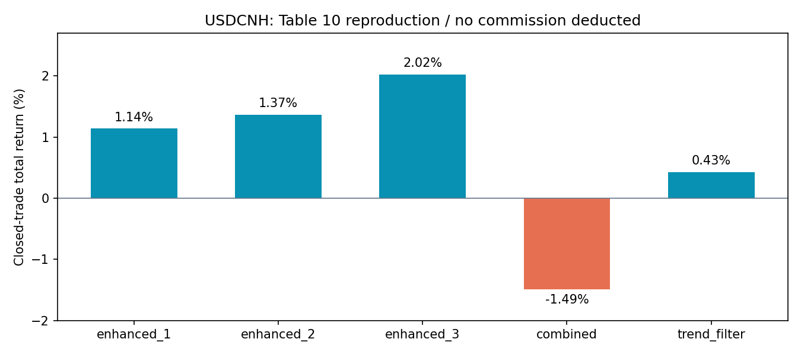

# FX Risk Sentinel

**From market data to volatility forecasts, model explanations and portfolio calculations.**

A Python research project combining economic indicators, technical features, XGBoost and historical backtests. This repository reconstructs and organizes the executable workflow in *FX Risk Sentinel: AI and Econometrics for Predictive Risk Analysis* (July 2025), credited to Yinquan Hou and Yixuan Wang.

This is a documented historical-method reconstruction. It is not a production trading system or a claim of leakage-free investment performance. The included demo inputs are independently generated synthetic data.

## What is implemented

| Stage | Implementation |
|---|---|
| Input preparation | Exact currency-pair mapping, Chinese/English OHLC columns, date validation |
| Feature construction | 11 technical indicators, daily alignment and the report's fixed-offset MIDAS weights |
| Historical selection | Correlation filtering, random-forest importance, Spearman IC and rolling IC standard deviation |
| Prediction | Time-ordered 80/20 split; median imputation, scaling and XGBoost |
| Interpretation | Optional SHAP beeswarm plot |
| Portfolio calculation | Five-asset rolling Markowitz with an explicit asset order and the original risk gate |
| Strategy reproduction | Five USDCNH single-asset parameter sets from Appendix L |

The five modeled pairs are USDJPY, EURUSD, EURJPY, USDCNH and JPYCNY.

## Run the included demo

Tested with Python 3.12. From this repository's root:

```bash
python -m venv .venv
# Activate the environment using the command appropriate for your shell.
python -m pip install -r requirements.txt
python run.py --demo --out artifacts/demo
python -m unittest discover -s tests -v
```

Add `--explain` to export SHAP plots. Demo data and their seed are documented in [data/demo/metadata.json](data/demo/metadata.json). They contain no original market observations and their metrics must not be presented as historical results.

## Use the original inputs locally

The source workbooks are not bundled. For the supplied `FX surf.zip` archive:

```bash
python scripts/import_private_data.py --archive "/path/to/FX surf.zip"
python run.py --data data/private --selection supplied --out artifacts/supplied
python run.py --data data/private --selection rebuilt --out artifacts/rebuilt --explain
```

`supplied` uses the archive's selected-feature matrices. `rebuilt` reconstructs indicators and re-runs selection from the mapped raw macro files. They are distinct experiments and need not produce the same features or scores. The available raw macro files do not fully explain every column in the archived final matrices.

The importer records input mappings and excludes malformed date rows. `data/private/` and `artifacts/` are ignored by Git. All commands use local paths rather than the original developers' desktop paths.

## Verified historical reference

Four reconstructed target series match the supplied target tables within `1e-10`; the missing USDCNH target was rebuilt from its prices. The target is:

```python
close.pct_change().rolling(20).std().shift(-5)
```

For USDCNH, the five Appendix L outputs match the report's Table 10 after rounding:

| Parameter set | Closed trades | Total return |
|---|---:|---:|
| enhanced 1 | 7 | 1.1430% |
| enhanced 2 | 7 | 1.3677% |
| enhanced 3 | 2 | 2.0247% |
| combined | 7 | -1.4900% |
| trend filter | 4 | 0.4278% |



These single-asset returns do **not** deduct the commission described in the report text, because the supplied strategy code did not implement it. Closed trades are compounded; an open final position is omitted, as in the source.

Aggregate tables and run provenance are in [results/reference](results/reference). See [reproduction notes](docs/REPRODUCTION.md) before interpreting scores.

## Method limitations

- The historical RF/IC feature selection uses full-sample targets before the test split. Consequently, the resulting test scores are not leakage-free estimates.
- The quantity called `IR` in the source is the **standard deviation** of rolling IC, not IC mean divided by IC standard deviation. It is named explicitly in exported scores here.
- The shifted target includes overlapping windows; no purging gap is applied.
- Non-JPYCNY risk classes use each array's own quantiles, while JPYCNY uses fixed report thresholds. These classes do not share one calibrated definition.
- The portfolio risk gate uses the entire prediction interval's high-risk fraction. In the verified reconstruction it never activated, so standard and filtered results coincide.
- Fixed 30/90-day MIDAS shifts do not reconstruct economic release dates or data vintages.

These limitations are retained for transparent reconstruction, rather than silently changing the method to obtain more attractive results.

## Repository map

- `fxrisk/`: reusable data, feature, model, backtest and command-line modules.
- `scripts/`: private-data import and reproducible synthetic-data generation.
- `data/demo/`: labelled synthetic inputs for an immediately runnable example.
- `results/reference/`: compact aggregate results from the original-data reconstruction.
- `docs/`: input schema, provenance and interpretation limits.
- `tests/`: checks for target timing, date mapping and risk thresholds.

The original project was collaborative. This repository does not infer individual authorship of every source module. See [provenance](docs/PROVENANCE.md) and [rights](RIGHTS.md).
